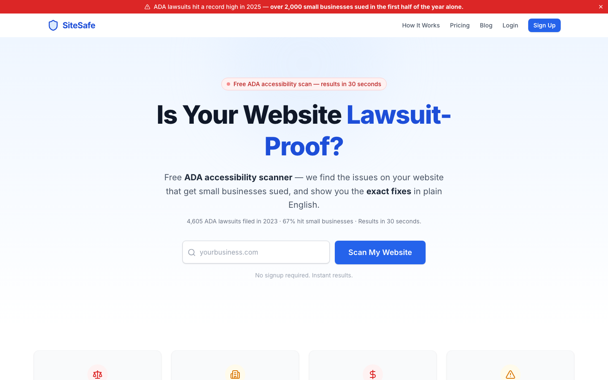
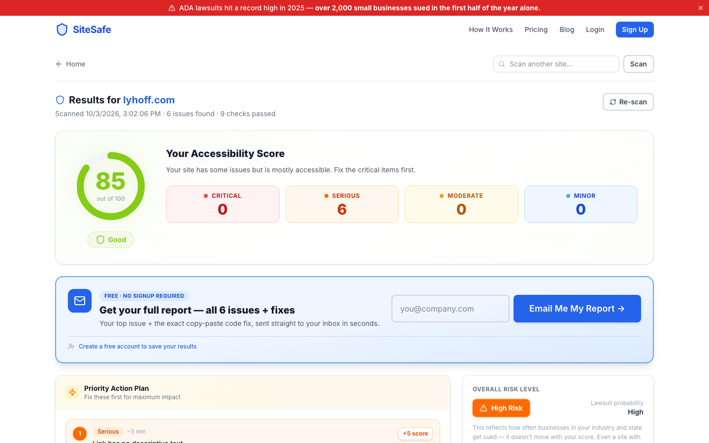
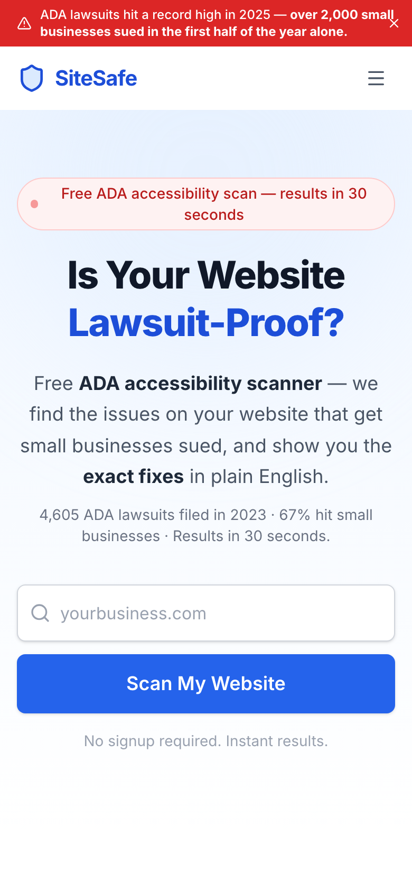

# SiteSafe — ADA Website Accessibility Checker

A self-service web app that scans any website for ADA/WCAG 2.1 AA accessibility violations, explains each issue in plain English, and provides copy-paste code fixes — so small businesses can catch problems before a lawsuit does.

**Live demo:** [adalawsuitcheck.com](https://adalawsuitcheck.com) — paste any URL on the home page, no account needed.



## What it does

1. Enter any URL — the scanner engine crawls it and runs 11 automated WCAG 2.1 AA checks (contrast, alt text, form labels, heading hierarchy, ARIA roles, and more).
2. Get a compliance score, a risk assessment, and an estimated legal-exposure cost.
3. Each violation ships with a plain-English explanation, the relevant WCAG success criterion, and a before/after code snippet — no accessibility background required to fix it.
4. Upgrade to a paid plan for full multi-page scans, a shareable report, and ongoing monthly re-scans.



## Tech stack

- **Frontend:** React 19, TypeScript, Vite, Tailwind CSS
- **Backend:** Supabase (Postgres, Auth, Row Level Security, Edge Functions)
- **Payments:** Stripe (subscriptions) + PayPal, both live
- **Hosting:** Cloudflare Pages
- **Scanner engine:** custom-built (no third-party accessibility API) — a Supabase Edge Function fetches the page HTML, and the 11 checks run in the browser against the parsed DOM

## Key features

- Custom WCAG 2.1 AA scanner engine with severity scoring and estimated fix time per issue
- Risk score + potential lawsuit cost estimate, based on real ADA litigation data
- Auth, dashboard with scan history, and shareable public reports
- Stripe + PayPal checkout with webhook-driven plan activation
- Automated re-scans and email alerts for subscribed sites

## Technical decisions

- **Own scanner instead of an accessibility API.** Each check is a small function in `src/scanner/checks/` that takes the parsed document and returns issues, so checks can be added or tested one at a time and there is no per-scan vendor cost.
- **Row Level Security on every user table.** A signed-in user can only read, insert or delete their own scans (`supabase/schema.sql`); the public site never reads other users' data.
- **Fetch on the server, analyze in the browser.** The Edge Function only downloads the HTML (avoiding CORS), and parsing/analysis happens client-side, which keeps the backend cheap and inside free-tier CPU limits. It also rate-limits by IP and refuses private/internal hostnames (`localhost`, `10.*`, `192.168.*`, `*.internal`) so it can't be pointed at internal networks.
- **Webhook-driven billing.** Plans are activated by the Stripe/PayPal webhooks, not by the browser after checkout, so a closed tab never leaves a paid customer without access.
- **Friendly failure states.** Sites that block automated requests (403) or time out return a clear message instead of a stack trace.

## Known limitation

The scanner currently reads raw HTML only (no JavaScript execution), so it's built for server-rendered sites — the majority of small-business sites (Shopify, WordPress, Wix, Squarespace). Client-rendered single-page apps are a known gap, tracked for a future headless-browser-based scan mode.

## Project layout

```
src/scanner/        scanner engine (runs in the browser): parser, 11 checks, scoring, risk + cost estimates
src/pages/          routes (landing, scan results, dashboard, checkout, shared reports)
src/components/     UI grouped by area (landing, scan-results, dashboard, checkout…)
supabase/functions/ Edge Functions: scan, checkout, billing portal, webhooks, follow-up emails
supabase/           schema.sql and migrations
```

## Running locally

```bash
npm install
npm run dev
```

Requires a `.env.local` with:

```
VITE_SUPABASE_URL=
VITE_SUPABASE_ANON_KEY=
VITE_STRIPE_PUBLISHABLE_KEY=
VITE_PAYPAL_CLIENT_ID=
```


